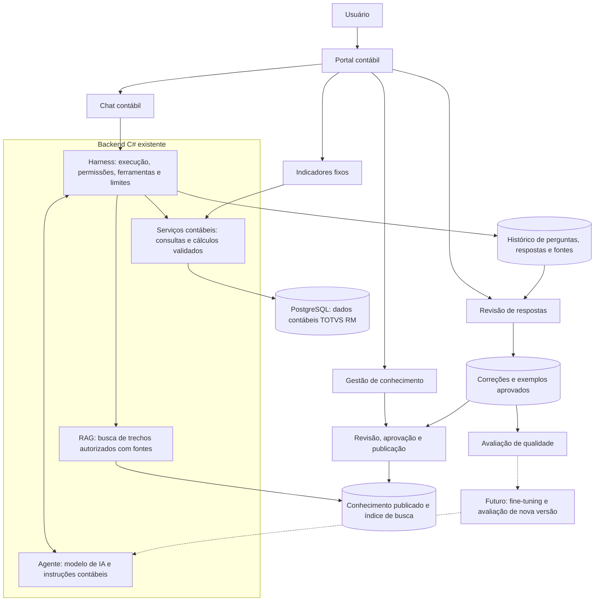

# Projeto do Agente Contábil — escopo, arquitetura e implementação

Versão 1.0 • 24/09/2026

Status: especificação consolidada para implementação. Este documento registra o desenho acordado; não declara componentes ainda não construídos como operacionais.

## 1. Objetivo

Entregar um portal contábil com indicadores fixos e um agente acessado por chat, capaz de consultar dados reais do TOTVS RM, explicar saldos e movimentações, recuperar conhecimento contábil da empresa e apresentar respostas rastreáveis. O usuário poderá alimentar uma base própria com documentos e regras e revisar respostas para melhorar continuamente o agente.

O projeto inicial é contábil. Contas a pagar, extratos bancários, conciliação bancária e projeção de caixa discutidos anteriormente ficam fora desta primeira entrega. Este documento é a referência para o escopo contábil atual; os documentos anteriores permanecem como histórico e visão mais ampla do ecossistema.

## 2. Ponto de partida e decisões

| Item | Situação |
|---|---|
| Backend | Existente, em C#, conforme informado pelo responsável |
| Portal e indicadores | Existentes, conforme informado pelo responsável |
| Consultas contábeis | Já validadas pelo responsável; serão reutilizadas |
| Agente e Harness do produto | A implementar no backend existente |
| Conhecimento/RAG | A implementar com documentos autorizados |
| Revisão de respostas | A implementar para registrar e aprovar correções |
| Fine-tuning | Evolução futura, condicionada a necessidade e evidências |

A existência dos componentes foi informada pelo responsável; o código e os contratos reais das APIs ainda precisam ser localizados para a integração. Não é necessário reconstruir o portal, o backend ou repetir a validação de negócio já concluída. Os testes novos verificarão a integração e a consistência entre painel e agente.

## 3. O que o projeto entregará

### 3.1 Indicadores e consultas contábeis

Reutilizar as visões existentes e disponibilizar ao agente as mesmas regras de cálculo:

- Saldo inicial e final por conta, empresa e período.
- Débitos, créditos e movimentação do período.
- Balancete e detalhamento por conta, conforme consultas disponíveis.
- Partidas que compõem os valores apresentados.
- Comparação entre períodos e análise de variações.
- Análises por filial e centro de custo, quando suportadas pelos dados.

A lista final de ferramentas será mapeada às APIs existentes. Uma visão que ainda não exista deve ser registrada como tarefa adicional, sem presumir que já está implementada.

### 3.2 Agente contábil via prompt

O agente responderá perguntas como:

- Qual é o saldo da conta X na empresa Y em agosto?
- Quais lançamentos compõem esse saldo?
- Quais contas explicam a variação entre dois períodos?
- Qual regra interna orienta a classificação nessa conta?
- Há possíveis inconsistências nos lançamentos selecionados?

Respostas numéricas terão filtros, período, data de atualização quando disponível e referências aos registros consultados. Respostas sobre procedimentos terão referências aos documentos e trechos utilizados. O agente pedirá esclarecimento quando conta, empresa, período ou intenção forem ambíguos.

A análise de variações identificará contribuições observáveis nos dados. Não apresentará uma causa de negócio como fato sem suporte documental ou evidência. Possíveis inconsistências serão hipóteses para revisão, não lançamentos automaticamente corrigidos.

### 3.3 Base própria de conhecimento

Área para cadastrar documentos, regras, descrições de contas, procedimentos e exemplos. O conhecimento terá responsável, versão, vigência quando aplicável, escopo de acesso e estado de publicação.

O RAG recuperará os trechos relevantes dessa base para apoiar a resposta. Não substituirá as consultas contábeis nem será usado como fonte de saldos atualizados.

### 3.4 Revisão e melhoria

O usuário autorizado poderá avaliar uma resposta, informar o problema, escrever uma correção e encaminhá-la para aprovação. A correção será vinculada à pergunta, à resposta original, às fontes e às versões utilizadas.

Após aprovação, a correção poderá virar conhecimento publicado, exemplo de comportamento ou caso de teste. Não haverá aprendizado automático a partir de toda conversa.

### 3.5 Entregáveis técnicos

- Módulo do agente e Harness integrado ao backend C#.
- Ferramentas contábeis com contratos e autorização no servidor.
- Endpoint de conversa e integração com o chat existente ou componente de chat a acrescentar.
- Pipeline de ingestão e busca documental.
- Área de gestão de conhecimento e revisão de respostas.
- Histórico de execução e evidências de uso das ferramentas.
- Conjunto de testes de qualidade e critérios de aceite.
- Configuração, guia de operação e procedimento de publicação/retorno de versão.

## 4. Arquitetura



As setas representam chamadas e dependências; as consultas retornam seus resultados pelo mesmo caminho. A base documental é logicamente separada dos dados contábeis, mesmo que parte do armazenamento utilize a mesma infraestrutura.

### 4.1 Responsabilidades dos componentes

| Componente | Responsabilidade |
|---|---|
| Portal | Identificar o usuário, apresentar filtros, indicadores, chat e telas de administração autorizadas |
| Harness | Coordenar chamadas ao modelo, validar ferramentas e argumentos, impor acesso, limites e registrar resultados |
| Agente | Interpretar a pergunta, solicitar ferramentas e explicar dados e conhecimento recuperados |
| Serviços contábeis | Executar consultas e cálculos existentes, mantendo a mesma semântica do painel |
| RAG | Buscar documentos vigentes e autorizados e retornar trechos identificados |
| PostgreSQL/RM | Fornecer registros contábeis pelos serviços existentes |
| Gestão de conhecimento | Controlar documentos, versões, aprovações e publicação |
| Avaliação | Medir correção, rastreabilidade, permissões e regressões antes de publicar mudanças |

A AUREN Factory é a estrutura de desenvolvimento do ecossistema. Seu Harness de desenvolvimento controla tarefas de programação. O Harness descrito aqui é do produto e controla o atendimento do agente contábil. A Factory não é uma dependência para cada pergunta do usuário.

## 5. Como uma pergunta será respondida

1. O portal envia pergunta, conversa e filtros ao backend com a identidade autenticada.
2. O Harness resolve as empresas permitidas no servidor; filtros fornecidos pelo usuário ou pelo modelo não ampliam esse acesso.
3. O Harness prepara instruções, contexto e ferramentas disponíveis para a chamada ao modelo.
4. O agente solicita uma consulta contábil, uma busca documental ou ambas.
5. O Harness valida os argumentos e executa a operação por serviços autorizados.
6. O resultado retorna ao modelo com referências e eventuais limitações.
7. O agente produz uma resposta apoiada nesses resultados.
8. O Harness registra ferramentas, fontes, versões, tempo, consumo e encerramento; o portal apresenta a resposta.

O ciclo permite mais de uma chamada de ferramenta, dentro de limites. Fonte indisponível, permissão negada e consulta vazia são resultados distintos. Nenhum deles pode ser convertido em saldo zero sem justificativa.

## 6. Ferramentas e integração C#

Proposta inicial de ferramentas, adaptável à nomenclatura do backend:

| Ferramenta | Entradas de negócio | Saída |
|---|---|---|
| ConsultarSaldo | Empresa autorizada, conta e período | Saldo inicial, débitos, créditos e saldo final |
| ConsultarMovimentacao | Empresa, período e filtros permitidos | Movimentos e totais com paginação |
| ConsultarPartidas | Empresa, conta/período ou identificadores | Partidas de origem e referências |
| CompararPeriodos | Empresa, contas e dois períodos | Valores comparáveis e variações calculadas |
| BuscarConhecimento | Pergunta, contexto e filtros autorizados | Trechos, documento, versão e localização |

Identidade e permissões são obtidas no servidor, não confiadas a argumentos do modelo. O agente não recebe credenciais de banco nem executa SQL arbitrário. Cálculos monetários usam a precisão adotada pelos serviços existentes; o modelo não é responsável por somar ou recalcular saldos.

Estrutura lógica proposta, sem obrigar reorganização do projeto existente:

```text
Backend C#
└── AgenteContabil
    ├── ChatEndpoint          # entrada da conversa
    ├── HarnessService        # ciclo de execução e controles
    ├── ModelClient           # integração com o provedor escolhido
    ├── Instrucoes            # instruções versionadas
    ├── Ferramentas           # adaptadores dos serviços existentes
    ├── Conhecimento          # ingestão e busca documental
    ├── Revisoes              # feedback e aprovação
    └── Avaliacoes            # testes de comportamento e qualidade
```

A escolha do serviço/modelo, bibliotecas, busca e transporte do chat será feita após conhecer as dependências existentes. Não é obrigatório adotar um framework de agentes para o primeiro ciclo.

## 7. Dados contábeis

Fontes de partida já apresentadas: CPARTIDA, CCONTA, CEXERCICIO, CSALDOEXERCICIO, GCCUSTO, GFILIAL e cadastros relacionados necessários às consultas existentes.

O arquivo de introspecção PostgreSQL e os scripts SQL enviados documentam estruturas, mas não substituem os contratos dos serviços validados. Não presumir equivalência automática entre o script de origem e a réplica PostgreSQL. A integração deve preservar as chaves e os filtros usados pelos serviços, inclusive IDBANCODADOS e coligadas quando aplicáveis.

O agente reutiliza os resultados já validados; deve evitar sumarizações que dupliquem partidas, mistura de períodos, comparação de filtros diferentes ou consulta de empresa não autorizada. Consulta histórica e situação atual devem permanecer distinguíveis.

## 8. RAG e conhecimento próprio

### 8.1 Fontes iniciais

- Plano de contas comentado.
- Regras e procedimentos contábeis da empresa.
- Critérios de classificação e de fechamento.
- Exemplos de perguntas e respostas aprovadas.
- Documentação das consultas e significado dos indicadores.

### 8.2 Ciclo documental

`envio → extração → revisão → aprovação → indexação → publicação → busca`

Cada documento deve registrar título, origem, responsável, versão, empresa/grupo autorizado, vigência quando aplicável e status. A busca deve respeitar esses atributos, inclusive em cache e reindexação. Revogar acesso ou retirar uma versão de publicação deve impedir seu uso em novas respostas.

O processamento extrai texto, divide em trechos e cria um índice de busca. A tecnologia do índice e eventual uso de embeddings serão definidos na implementação. Os arquivos originais ficam em armazenamento controlado; o índice não precisa ser a única cópia do documento.

Trechos recuperados são conteúdo de referência, nunca instruções que possam modificar permissões ou ferramentas. Em caso de documentos conflitantes, o agente informa a divergência e prioriza fontes vigentes aprovadas segundo regra explícita. Se não houver fonte adequada, informa a ausência.

Formatos de arquivos, tamanho máximo, retenção e necessidade de OCR ainda precisam ser definidos. Não está assumido suporte universal a PDF digitalizado ou qualquer tipo de anexo.

## 9. O que significa ensinar e treinar

| Mecanismo | Aplicação no projeto | Altera pesos do modelo? |
|---|---|---|
| Instruções | Orientar comportamento, ferramentas e formato de resposta | Não |
| RAG | Consultar conhecimento próprio atualizado | Não |
| Exemplos/correções | Melhorar orientações, base e testes após revisão | Não, por si só |
| Fine-tuning | Ajustar um modelo compatível usando exemplos aprovados | Sim |

A primeira versão entrega conhecimento próprio e um processo de correção supervisionada. Não promete que o modelo aprenderá sozinho nem inclui treinamento de um modelo do zero.

Fine-tuning é uma evolução opcional: reunir exemplos autorizados, remover conteúdo inadequado, separar dados de treino e avaliação, comparar a versão ajustada com a atual e só publicar se houver ganho comprovado. Saldos e lançamentos mutáveis continuam sendo consultados, não memorizados como fonte de verdade.

## 10. Controles do Harness

- Autenticação integrada ao portal e autorização por empresa em cada ferramenta e documento.
- Operações contábeis somente de leitura. Escrita restrita aos registros próprios de conversa, conhecimento, revisão e configuração por usuários autorizados.
- Lista explícita de ferramentas e validação de argumentos, períodos e volume retornado.
- Segredos apenas no backend; logs sem credenciais e com proteção de dados sensíveis.
- Instruções e configuração versionadas, fora do alcance de alteração por conteúdo de chat ou documento.
- Timeout, cancelamento, teto de chamadas de modelo/ferramenta, tamanho de contexto e orçamento configuráveis.
- Nenhuma tentativa infinita; ao atingir limite, registrar interrupção e informar o usuário.
- Política de envio de dados ao provedor, retenção, acesso ao histórico e tratamento de anexos definida antes do piloto com dados reais.

Os valores numéricos dos limites do produto serão definidos antes da primeira execução. Os limites propostos anteriormente para agentes de desenvolvimento da Factory não devem ser copiados automaticamente para uma conversa contábil.

## 11. Histórico e entidades lógicas

Proposta a adaptar à persistência existente, sem exigir agora um novo banco:

| Entidade | Conteúdo |
|---|---|
| Conversa/mensagem | Usuário, contexto, pergunta, resposta e estado |
| Execução | Modelo, versões, ferramentas, duração, consumo e encerramento |
| Evidência | Referências de consulta, filtros, registros e fontes documentais |
| Documento/versão/trecho | Arquivo, conteúdo, vigência, publicação e permissões |
| Revisão | Avaliação, correção, aprovador e destino da melhoria |
| Caso de avaliação | Pergunta, contexto, resultado esperado e critérios |

O armazenamento detalhado e os prazos de retenção serão definidos na implementação. Não é necessário guardar indiscriminadamente todo o conjunto de dados consultado.

## 12. Etapas de execução

| Etapa | Trabalho | Entrega verificável | Dependência |
|---|---|---|---|
| 0. Localizar integração | Examinar backend, autenticação, APIs e portal existentes | Mapa de serviços e pontos de integração | Caminho do código |
| 1. Primeiro ciclo | Criar cliente de modelo, instruções, Harness e ConsultarSaldo | Pergunta recebe saldo correto com referência | Modelo/credencial e acesso ao serviço |
| 2. Chat no portal | Conectar endpoint de conversa e filtros | Usuário pergunta no portal e recebe resposta | Etapa 1 |
| 3. Consultas complementares | Adicionar movimentos, partidas e comparação | Explicação rastreável de saldo e variação | Serviços correspondentes |
| 4. Conhecimento/RAG | Implementar envio, aprovação, indexação e busca | Resposta com fonte documental autorizada | Documentos e responsáveis |
| 5. Revisão e avaliação | Registrar correções e criar testes de qualidade | Melhoria aprovada e regressões verificadas | Histórico e casos reais |
| 6. Piloto e publicação | Conferir acesso, limites, desempenho e operação | Versão aprovada para grupo piloto | Critérios obrigatórios atendidos |
| 7. Evolução opcional | Avaliar fine-tuning com exemplos revisados | Comparativo e decisão de adoção | Necessidade demonstrada e conjunto adequado |

Permissões, limites e registros começam na etapa 1 e são ampliados com as ferramentas. Não ficam adiados para o fim. Prazos serão estimados após examinar o código e os contratos existentes.

## 13. Primeira tarefa de implementação

**CONT-001 — Consultar saldo pelo agente contábil no backend C#.**

Objetivo: uma pergunta com empresa, conta e período deve acionar o serviço existente e receber uma resposta correta, rastreável e limitada ao acesso do usuário.

Entradas: código do backend, contrato da consulta, autenticação existente, um modelo configurado, limites de execução e um caso de referência já validado.

Entregas: Harness mínimo, cliente do modelo, instruções versionadas, ferramenta ConsultarSaldo, endpoint de conversa, registro da execução e testes de integração pertinentes. O chat visual pode ser conectado na etapa seguinte.

Aceite da tarefa:

1. Para o caso de referência, os números retornados coincidem com o serviço/painel existente.
2. A execução comprova a chamada à ferramenta; números não são inventados pelo modelo.
3. Empresa não autorizada é bloqueada no servidor.
4. Pergunta ambígua solicita o filtro necessário.
5. Falha do serviço ou ausência de dados é comunicada corretamente.
6. Limites de execução encerram o ciclo e geram registro verificável.
7. Nenhuma alteração é feita nos dados contábeis.

## 14. Critérios de aceite do projeto

| ID | Critério |
|---|---|
| AC-01 | Painel e agente retornam os mesmos valores para os mesmos filtros |
| AC-02 | Saldos e variações podem ser detalhados nas partidas de origem |
| AC-03 | Dados e documentos de outra empresa não são acessíveis sem autorização |
| AC-04 | Perguntas sobre regras usam documentos aprovados e citam sua origem |
| AC-05 | Documento ausente, conflitante ou insuficiente não gera afirmação inventada |
| AC-06 | Instruções inseridas em documentos não alteram ferramentas nem permissões |
| AC-07 | Correção de usuário só entra no conhecimento publicado depois de aprovação |
| AC-08 | Respostas registram versões e referências suficientes para investigação |
| AC-09 | Timeout, cancelamento e limites funcionam sem ciclos ilimitados |
| AC-10 | Indicadores permanecem disponíveis independentemente da disponibilidade do modelo |
| AC-11 | Nova versão de instrução, conhecimento ou modelo passa pelos casos de avaliação |
| AC-12 | Não existe execução autônoma ou notificação programada nesta versão |

As avaliações usarão perguntas reais, casos de referência já validados e cenários negativos de acesso e indisponibilidade. O responsável contábil aprova a interpretação; os testes conferem integração, rastreabilidade e controles.

## 15. Responsabilidades e decisões pendentes

| Responsável | Atuação |
|---|---|
| Responsável do produto/contábil | Definir prioridades, fornecer casos e documentos, aprovar interpretações e correções |
| Desenvolvimento | Integrar agente, Harness, ferramentas, RAG e interface; produzir testes e documentação |
| Administração técnica | Configurar credenciais, ambientes, acesso, retenção e limites |

Pendências para iniciar: caminho do backend e portal; contratos dos serviços; mecanismo de autenticação; provedor/modelo e configuração segura; casos de teste; responsáveis por publicar conhecimento. Para o RAG: documentos iniciais, formatos e política de acesso. Essas decisões não exigem reconstruir os componentes já existentes.

## 16. Fora do escopo inicial

- Contas a pagar e receber, extratos, conciliação bancária e projeção de caixa.
- Alterar lançamentos, executar fechamentos ou fazer correções automáticas no ERP.
- Monitoramento contínuo, agendamento e envio automático de alertas.
- Treinar um modelo do zero ou entregar fine-tuning como condição para o piloto.
- Substituir o backend C#, o portal ou as consultas já validadas.
- Construir toda a AUREN Factory antes de entregar o agente do produto.

## 17. Resultado esperado

O usuário acessa o portal existente, vê seus indicadores, pergunta ao agente o que explica um resultado e recebe uma resposta baseada nas consultas validadas e no conhecimento autorizado. Pode revisar e corrigir essa resposta, formando uma base própria governada e um conjunto de avaliação para evoluir o agente com segurança e evidências.
